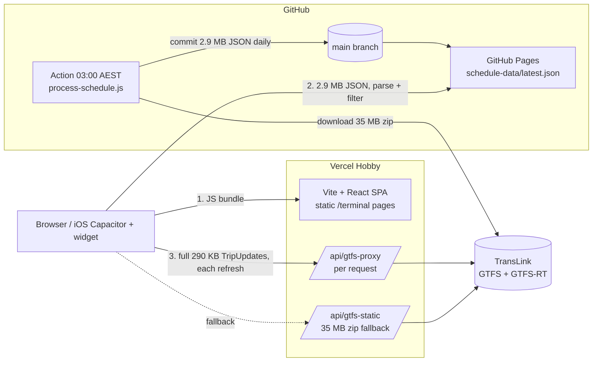
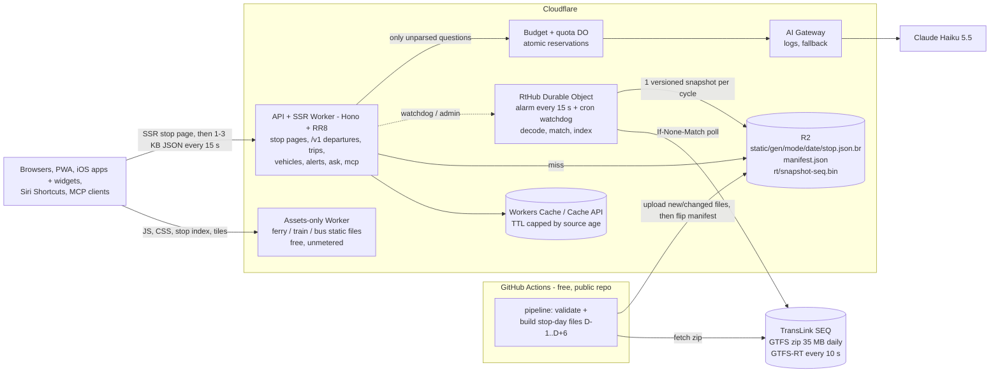

# Brisbane Ferry, Train, Bus and Transit: target architecture

Status: proposal, 18 October 2026. Branch `docs/transit-architecture`. Documents only: no app code changes.
Related: [ADRs](./adr/), [Codex cross-review](./review-codex.md), [measurement scripts](./measurements/), design canvases in `~/Dev_local/BrisFerry/bft-transit-design-report.md`, lessons in `~/Dev_local/BrisFerry/docs/archive/mode-abstraction-v2-learnings.md`.

## 1. One-page summary

**The problem today.** Every browser downloads a 2.9 MB schedule JSON from GitHub Pages (78 KB gzipped on the wire, but 2.9 MB to parse) and filters it. Every browser also pulls the full 290 KB network-wide TripUpdates feed through a Vercel function every refresh. Schedule data is committed to git every day (461 commits so far). This works for 32 ferry stops. It cannot work for 12,400 bus stops, and the per-user proxy does not scale in cost.

**The measurements that drive the design** (SEQ GTFS of 17 October 2026, measured locally):
- **One service day of the whole SEQ network, split into one file per stop (per station for train), is 11.5 MB gzipped in total.** These files hold everything needed to answer "from here to there":
  - downstream **arrival** times, in seconds
  - pickup and drop-off rules
  - stop sequence and trip ID
- **The files are small.** Median 0.6 KB, p95 2.5 KB, largest 24 KB (a busway platform).
- **The realtime feed is manageable.** Network-wide GTFS-RT TripUpdates is 290 KB at Saturday midday (1,231 trips, 21,830 stop updates). It decodes in 13 ms, and TransLink refreshes it every 10 s (`Cache-Control: max-age=10`).

These are lower bounds for the final format. Phase 0 re-measures once the contract is fixed. Even so, a departure board needs only a few KB, and one shared poller can index the whole network.

**The target, in one line per part:**
1. **Static timetable:** a daily GitHub Action builds immutable per-stop, per-service-day files for a 7-day lookahead. They go to **Cloudflare R2** under a versioned "static generation", and a manifest flips atomically. Nothing goes in git.
2. **Realtime:** one **Durable Object** polls TransLink every 15 s for everyone and writes a versioned snapshot to R2. Edge Workers merge static and live data per stop, only when the two generations are compatible, and answer with **1–3 KB JSON** (edge TTL ≤ 10 s). Clients pull every 15 s while visible. No push at first.
3. **Hosting:** move from Vercel to **Cloudflare**. Static assets go in an assets-only Worker, where requests and bandwidth are free. A separate API and SSR Worker serves departures and stop pages. The Brisbane PoP serves both.
4. **Search and nearby:** done client-side. A lazy stop index (train 6 KB, bus 214 KB gz) is searched with uFuzzy, and nearby uses geohash tiles. There is no search server.
5. **Frontend:** Vite 8, React 19.3, React Router 8 framework mode, Tailwind 4.3, MapLibre GL 6. Stop and station pages are **server-rendered at the edge with live departures**, everything else is static, and it is a PWA. Capacitor 8 for iOS and the widget.
6. **Repo:** a pnpm + Turborepo monorepo. It holds `packages/core` (GTFS time, calendars, trip matching, API contract), `packages/ui`, one edge service, one pipeline, and **three standalone apps with build-time mode**. This keeps the April 2026 decision: no runtime mode switching.
7. **AI layer:** optional and kill-switchable `/v1/ask`. A deterministic parser runs first. Only the leftovers go to **Claude Haiku 5.5** via **Cloudflare AI Gateway**, with tool calls against our own API. Turnstile, per-IP quotas and a hard monthly budget protect it. The same tools are exposed read-only as an MCP server.

**Cost (base scenario):** about **$0–5/month at 1k DAU**, **about $9 at 10k** (including about $4 of AI), and **about $37 of infrastructure plus up to $25 of capped AI spend at 100k**. A heavy-use scenario (120 requests per DAU a day) at 100k is about $124 of infrastructure. Halving the poll rate roughly halves that. The fixed cost is the $5 Workers Paid plan, needed from about 3k DAU or as soon as the poller outgrows Free CPU. Details are in §6.

**Migration:** ferry goes first, without breaking prod. Build the data plane, shadow-compare it against today's output, cut ferry data over behind a flag, then move ferry into the monorepo and onto Cloudflare. Train and bus follow, then multimodal. There are nine phases of two weeks or less (§7).

## 2. Current architecture (as of commit 96b9b8d)



Pain points:
- **LCP chain:** the bundle, then a third-party origin (new TLS connection), then 2.9 MB of `JSON.parse` and filtering, then a cold proxy function, then decoding 290 KB of protobuf in the browser.
- **Proxy cost:** cost grows with users × refreshes × 290 KB. At 100k DAU that would be hundreds of GB per day.
- **Data in git:** the schedule data is committed daily.
- **The iOS app is coupled to two URLs:** `thebnut.github.io/.../latest.json` and `www.brisbaneferry.com/api/gtfs-proxy`. Old builds keep calling both, so both must survive the migration (see §7, Phase 2).

## 3. Target architecture



### 3.1 Request path for "departures at my stop" (the LCP path)

1. `GET /train/station/bowen-hills` goes to the API and SSR Worker. React Router 8 renders the station route on the server.
   - Its loader calls the departures function in-process, with no extra HTTP hop.
   - The response is streamed HTML with **the departure rows already in the markup**, plus the same data as hydration state.
   - First paint shows departures before any JS runs. This is a deliberate server-rendering path, and these page views are metered requests (§6).
2. Static files come from the assets-only Worker: JS (about 70 KB gz for React 19, the router and core), CSS and the stop index. Those requests are free.
   - The map (MapLibre, about 250 KB gz) loads only when opened.
3. Refreshes call `GET /v1/train/stops/{key}/departures?to=…`. The response is 1–3 KB, its `max-age` is capped by the snapshot's source age, and the client polls every 15 s.

Indicative budget on Lighthouse "slow 4G" (1.6 Mbps, 150 ms RTT), from the Brisbane PoP, warm edge cache:

| Step | Time |
|---|---|
| Connection and TLS | about 450 ms |
| SSR HTML with rows (≤ 20 KB) | about 200 ms |
| CSS (≤ 10 KB, inline critical) | about 50 ms |
| Render | about 100 ms |
| **Total** | **about 0.8 s to LCP** |

The JS arrives after LCP and doesn't block the departure rows. A cold cache adds a manifest read, a stop-file read and a snapshot read, about 50–150 ms in-region.

**1.5 s is an acceptance target, not a demonstrated result.** Phase 3 measures it, cold and warm, on a mid-range Android. For comparison, the current ferry chain needs at least four sequential round trips, one of them to a third-party origin.

### 3.2 Static timetable pipeline (ADR-0002)

- **Where:** GitHub Actions, daily at 03:00 AEST, plus a manual trigger. This repo is public, so it costs nothing. Workers can't do this job: 128 MB of memory is too small for the 199 MB `stop_times.txt`. Cloudflare Containers or Workflows would add cost for no gain. Measured: one Python pass over the whole zip takes 6 s, so a Node/TS build will take minutes, not hours.
- **Validation (two classes, per Codex finding 5).**
  - **Structural corruption fails closed.** The build stops, and the previous generation keeps serving. Triggers:
    - [MobilityData gtfs-validator](https://github.com/MobilityData/gtfs-validator) reports ERROR-level notices
    - files missing or unparseable
    - referential breaks
    - `feed_end_date` earlier than today + 7
    - golden fixtures failing (§3.7)
  - **Plausible service changes are quarantined, not rejected.** Triggers:
    - per-mode trip counts move more than ±20% from the previous feed
    - a terminal or station has zero service on a day its calendar says is active
  - When a change is quarantined:
    - the build publishes to a staging generation and opens a GitHub issue
    - an override (`workflow_dispatch` with `accept=<generation>`) promotes it
    - zero-service days that `calendar_dates` explains (planned closures) pass automatically
  - Rejecting the whole feed would keep serving exactly the services TransLink has withdrawn, so a quarantine is safer.
- **Lookahead: 7 days.**
  - Each run builds service days D−1 through D+6 from the feed. The feed itself covers about 60 days.
  - When a run fails, future dates stay buildable from the **last valid source feed**, so service survives six consecutive failed runs.
  - D−1 is kept because, after midnight, departures from 24:00 onwards belong to yesterday's service day (finding 6).
- **Format: one immutable, content-addressed file per stop per service day,** at `static/blobs/{sha256}.json.br`.
  - A per-generation index, `static/{generation}/{mode}/index.json`, maps `(date, stopKey) → hash`. For bus it is about 200 KB gz. The Worker loads it once per isolate.
  - Weekday timetables are mostly identical day to day, and so are back-to-back feed versions, so a run uploads only blobs whose content changed. That matters if TransLink republishes the feed daily.
  - Train keys by parent station, so platform is a field. Bus, ferry and tram key by `stop_id`.
  - Each row is a **stop event**: `[tripInstance (trip_id + service date), stopSequence, depS, routeShort, headsignIdx, platformStopId, pickupType, downstream[(stopIdx, arrS − depS, dropOffType)…]]`.
  - Downstream entries use **arrival** times and include only stops where alighting is allowed.
  - Events with `pickup_type=1` (no boarding) are excluded. The feed has 137,754 such events and 8,533 pass-through events.
- **Why individual files, not packs.** Codex finding 11 was right that a custom pack format (index, range reads, corruption handling) costs more engineering than it saves.
  - Worst case, with no dedupe, a run writes a full new day: about 12.5k files, or about 375k R2 Class A operations a month.
  - A rewrite of all 8 days (about 100k operations) happens only when the content actually changes, because blobs are content-addressed.
  - The total stays under the 1M free tier. Even at double that, the cost is about $4.50 a month.
  - Phase 0 benchmarks this against grouped shards, and against a "pattern + trip-times" representation that avoids repeating downstream suffixes.
- **Why JSON inside brotli, not protobuf, MessagePack, SQLite or DuckDB-WASM:**
  - Per-stop payloads are 2.5 KB at p95. A binary codec saves about 20% and costs debuggability.
  - SQLite-WASM or DuckDB-WASM would put 1–4 MB of WASM on the LCP path.
  - Parquet only suits analytics.
- **Offline:**
  - A whole service day for **train is 300 KB gz** and for **ferry 30 KB gz**. Those apps can prefetch today into the service worker.
  - Bus caches only saved and nearby stops (0.6 KB median each).
- **Generations and cache invalidation (finding 4).**
  - Every build is an immutable **static generation** (`gen = feedVersion + build hash`), made up of its index plus the blobs it references.
  - Blobs and indexes are `max-age=31536000, immutable`.
  - `manifest.json` (`max-age=60`) is written last, so the switch is atomic. It maps `mode/date → generation` and keeps the previous generation for rollback.
  - The RT snapshot records the generation its trip index was built from. The Worker merges static and RT data **only when generations match**. If they don't, it serves scheduled-only rows with `rtState: "reloading"` until the hub has reloaded.
  - Every API response carries `schemaVersion`, `staticGeneration`, `serviceDates` and `rtSourceTimestamp`.
  - A weekly pipeline garbage-collection step deletes indexes older than 14 days, and any blobs no retained generation references.
- **Static client data**, built by the same pipeline into each app's static assets at deploy time and also published to R2 for daily refresh:
  - `stops.{hash}.json`: the search index.
  - `geo/{geohash5}.json`: nearby tiles.
  - `lines.{hash}.json`: route colours from GTFS `route_color`, plus stopping patterns (train 156 patterns, 2 KB gz; bus 1,114 patterns, 47 KB gz).
- **Map stops layer:** bus stops ship as a PMTiles archive on R2 (pmtiles 4.5), so the map can draw 12k stops without a GeoJSON download. Train and ferry stop counts are small enough to inline as GeoJSON.

### 3.3 Realtime (ADR-0003)

- **One shared poller.** The `RtHub` Durable Object (location hint `oc`) runs an alarm every 15 s.
  - It fetches the combined `TripUpdates` and `VehiclePositions` feeds every 15 s and `alerts` every 60 s, using `If-None-Match` with TransLink's ETag.
  - That is about 12,000 requests a day to TransLink **regardless of user count**.
  - TransLink publishes under CC BY 4.0 with no authentication and no stated rate limit. A 15 s interval is above its 10 s `max-age`, so this is polite polling.
- **Scheduler robustness (Codex finding 8).** Alarms run at least once with finite retries. They don't schedule themselves.
  - The handler **re-arms the next alarm first**, before doing any work, and again in `finally`.
  - Each upstream fetch has a 5 s timeout.
  - Publishing is idempotent: the snapshot key includes the sequence number, and a small `rt/latest.json` pointer is written after it.
  - A **Cron Trigger every minute** acts as a watchdog. It calls `ensureRunning()` on the DO, which re-arms the alarm if the last successful cycle is more than 45 s old.
  - Alert summaries (§3.9) run asynchronously and never sit on the polling path.
  - The last raw protobufs are kept in DO storage as well as memory. After a restart, the legacy proxy serves those, or nothing, but never triggers its own upstream fetch.
- **Trip-instance identity and matching (finding 2).** RT trips are matched to **trip instances** (`trip_id` + service date) in the hub, using `packages/core` (ADR-0007). Tiers:
  1. Exact `trip_id` + `start_date`.
  2. The RT descriptor's `(route_id, direction_id, start_time, start_date)`, which must identify exactly one instance.
  3. For rail, the stable trip-ID prefix plus route, plus a compatible stop pattern. This is lifted from the archive's `useTrainData.js`, with a uniqueness check added.
  4. Same route, same direction, compatible stop pattern, departure within ±5 minutes at a matched `stop_sequence`, **and exactly one candidate**. This is lifted from `ferryData.js mergeDepartures`, with the uniqueness check added.
  
  **Ambiguous matches stay unmatched.** That row shows as scheduled, which is safer than attaching another trip's delay. Metrics record coverage, *ambiguity* and a sampled precision check against tier 1. Adversarial fixtures cover:
  - frequent routes (6-minute headways)
  - loops that repeat a stop
  - branches
  - opposite directions at shared stops
  - trips that cross midnight
- **Stop-event state machine (finding 3).** For each matched trip instance and `stop_sequence`, the hub records:
  - separate arrival and departure predictions (time or delay, with uncertainty if given)
  - `schedule_relationship`: SCHEDULED, SKIPPED or NO_DATA
  - the trip's relationship: SCHEDULED, CANCELED, ADDED, DUPLICATED or REPLACEMENT
  - the feed entity timestamp
  
  Rules:
  - A delay propagates downstream only until the next explicit update, and **never through NO_DATA**.
  - SKIPPED stops render as "not stopping here".
  - CANCELED trips stay cancelled until their scheduled end, even if the RT feed goes stale. A stale cancellation shows "status unknown", never a silent return to scheduled.
  - ADDED and DUPLICATED trips appear only if they carry a stop list we can resolve. Otherwise they are counted and dropped.
  
  The hub holds trip indexes for **yesterday's and today's** service days in typed arrays (about 2 MB each), so a departure at 25:10 on yesterday's service day still matches at 01:10.
- **Snapshot.** Each cycle the hub writes **one combined object** to R2, `rt/snapshot-{seq}.bin`, then points `rt/latest.json` at it.
  - It is brotli-compressed JSON:
    - a header: `schemaVersion`, `staticGeneration`, `serviceDates`, `sourceTimestamp` (the TransLink header time) and `fetchedAt`
    - a stop-event table keyed by stop
    - vehicles and alerts tables
  - That is about 175k R2 writes a month, under the 1M free.
  - If the snapshot exceeds about 300 KB compressed, split it by mode.
- **Edge read path.**
  1. The Worker keeps the parsed snapshot in isolate memory.
  2. It refreshes when `now − fetchedAt > 10 s`, through a shared cache entry. In-flight refreshes in one isolate share one promise.
  3. Per request it merges the static stop file with the stop-event table, then returns the response.
  
  - **Cache lifetimes are capped by source age:** `max-age = max(0, 10 − (now − fetchedAt))`.
  - The DO is **not** on the per-request path, so DO request charges don't grow with traffic.
  - The Cache API does **not** coalesce misses across isolates, so Phase 1 benchmarks Cloudflare's newer **Workers Cache** (pre-Worker caching with request collapsing) for `/v1` responses. It applies only to the API Worker. The assets-only Worker stays outside it so static requests stay free.
  - Snapshot reads are about 260k a month per continuously active PoP. With roughly 3–5 Australian PoPs that is under or near the 10M free Class B operations.
- **Freshness (finding 7).** Freshness here means source timestamp to what's on screen. Worst case, misaligned timers add up:

  | Stage | Worst case |
  |---|---|
  | TransLink's own update | 10 s |
  | Hub poll | 15 s |
  | Edge snapshot refresh | 10 s |
  | Response cache (capped, so it overlaps the refresh) | 0 s |
  | Client poll | 15 s |
  | **Total** | **about 50 s** |

  The expected p50 is about 20–25 s. Every response carries `rtSourceTimestamp`, and the UI shows "updated n s ago" from it, so a refreshed cache never resets the apparent age. Phase 1 measures p50, p95 and the worst case with deliberately misaligned timers.
- **Pull first, hibernating WebSockets as a measured option (finding 14).**
  - Short-TTL cached JSON is simple, CDN-friendly, and good enough for departure boards.
  - The client polls every 15 s while visible and pauses when hidden.
  - Cloudflare's **WebSocket Hibernation API** keeps idle connections open without duration billing, and could push change-only updates to long-lived views such as service detail and the live map.
  - Phase 4 prototypes it for the train service-detail view, comparing fan-out cost, reconnect behaviour and freshness against polling.
  - SSE is not pursued: it holds a non-hibernating request.
  - APNs push stays limited to a future opt-in iOS Live Activity.
- **Compatibility:** the legacy `/api/gtfs-proxy?endpoint=…` route is kept and served from the hub's stored raw feed, so old iOS builds keep working without per-user TransLink calls.

Platform comparison for the poller:

| Option | Can poll every 15 s? | Cost at hobby scale | Verdict |
|---|---|---|---|
| **Cloudflare Durable Object + alarms** | Yes. Alarms at any interval. | Free plan: 100k req/day and 13,000 GB-s/day (a 15 s alarm uses 5,760 req/day). Paid plan includes 1M req and 400k GB-s a month. | **Chosen.** It sits beside the edge cache, and alarms are durable. |
| Cloudflare Cron Trigger + KV | No. The minimum is 1 minute, and KV allows only 1,000 writes/day on Free. | Free | Rejected: too coarse, and KV write limits. |
| Vercel Cron / Fluid compute | No. Hobby cron runs once a day. Pro cron is minute-level. | $20/mo Pro | Rejected: cost, and still per-minute. |
| Fly.io machine | Yes | About $2–3/mo (no free tier for new orgs). Egress is billed. | A runner-up, but it is another platform to run. |
| Deno Deploy + `Deno.cron` | No. The minimum is 1 minute. | Free tier | Rejected: too coarse. |
| Supabase pg_cron + Edge Function | Minute-level | Free, but projects pause after 7 days inactive | Rejected: a database it doesn't need, and the pause risk. |

### 3.4 Search and nearby (ADR-0004)

- **Search is client-side.**
  - A per-app stop index is lazy-loaded after first paint and cached by the service worker. Measured sizes: ferry 0.7 KB, train 6 KB, bus 214 KB gz. All 12,863 stops would be 221 KB.
  - Matching uses `@leeoniya/ufuzzy` 1.0.19 (about 4 KB). It is tuned for short names and typos ("bowen hils"), and bus stop numbers also match exactly.
  - The archive lesson applies: use a headless combobox (Ark UI or Radix) with a portal, not a home-made dropdown.
- **Nearby uses geohash-5 tiles,** each about 4.9 km square and a few KB. The client fetches its tile and the 8 neighbours, then sorts by haversine distance. There is no server.
- **Why not server-side search:** a search server is per-keystroke traffic, a cold-start risk and more code. Even the largest index fits in a single image's worth of bytes. Revisit only if multimodal needs addresses or POIs. Then add Photon or Pelias, or a provider API, behind `/v1/geocode`.

### 3.5 Frontend (ADR-0005)

| Concern | Choice (Oct 2026 version) | Newest credible alternative | Why |
|---|---|---|---|
| Build | **Vite 8.3** (Rolldown) | Same | Already in use, and the fastest option. |
| UI | **React 19.3** | SolidStart 2.0 | Reuses the ferry components and the team's knowledge. Solid would mean a rewrite. |
| Routing / rendering | **React Router 8.4 framework mode on Workers**: SSR with live departure rows for stop and station routes (bus has 12k of them, too many to prerender usefully), `prerender` for static pages (home, about, line pages), SPA navigation after hydration | TanStack Start 1.169, Next 16.4, Astro 7.4 | RR8 is the smallest step from today's SPA, and one route module supports SSR, prerender and SPA. There is a server runtime, the API Worker, and that is deliberate (Codex finding 12). TanStack Start is a close second: type-safe routes, SSR-first, younger. Next 16 pulls toward Vercel and RSC complexity. Astro islands would split the app across two paradigms. |
| Styling | **Tailwind 4.3** with a shared preset per mode colour | — | v3 is legacy. v4's CSS-first `@theme` suits per-app brand tokens. Already on the maintenance backlog. |
| Map | **MapLibre GL 6.14** (native, no Leaflet) on OpenFreeMap tiles | Leaflet 1.9 | The vector style matches the design canvases. It is already a dependency through `maplibre-gl-leaflet`, so this drops a layer. Lazy-loaded. |
| Data fetching | **TanStack Query 5.104** | SWR | Polling, visibility pause, stale-while-revalidate and offline persistence are built in. |
| PWA | **vite-plugin-pwa 2.0** (Workbox) | — | Offline departures for saved stops and installability. |
| Native | **Capacitor 8.5** per app, each with a WidgetKit extension; App Intents for Siri and Shortcuts | Expo / React Native | Keeps one web codebase, and the ferry widget already exists. |
| Lint / format | **Biome 2.5** (single tool) | oxlint 1.88 + Prettier | One fast tool. oxlint is also credible. Either replaces ESLint 10. |
| Language | **TypeScript 7.0** (native compiler) in `packages/*`. Apps migrate file by file. | — | The core contract and matching code need types. |
| Tests | **Vitest 5**, **Playwright 1.64**, Lighthouse CI budget | — | — |

### 3.6 Monorepo and apps (ADR-0006)

```
brisbane-transit/                 pnpm workspaces + Turborepo 2.11
  apps/ferry  apps/train  apps/bus  (apps/transit later)   # thin: routes, screens, brand
  packages/core      # TS: GTFS time/calendar, trip matching, contracts (zod), stop-event codec
  packages/ui        # React components: DepartureRow, CountdownChip, StatusBadge, StopSearch, MapView
  packages/config    # Tailwind 4 preset, Biome, tsconfig
  services/edge      # API + SSR Worker: /v1 API, SSR stop pages, RtHub + budget DOs, cron watchdog, /mcp, /v1/ask
  services/assets    # assets-only Workers (one per app domain): free static serving
  pipeline/          # static GTFS → stop-day blobs + generation index, validators, golden fixtures
```

- **The April 2026 decision is kept.** There are three standalone apps, each with its own domain, brand, bundle and iOS app. The mode is fixed at build time. Shared code lives in packages, not in a runtime `ModeProvider`. The multimodal app becomes a fourth thin app built from the same packages, the "Mode Tabs" design. It is not a mode switch inside the others.
- **One API and SSR Worker serves all three apps,** routed by host, so they share the poller, the snapshot and the cache.
  - Each app's static files sit in its own assets-only Worker, reached through routes for `/assets/*` and similar paths, or through a service binding.
  - Static traffic never runs metered Worker code.
- **Repo:** convert this repo in place, so history, the issue links and the Pages URL survive. Ask Brett (see §9).

### 3.7 Shared core (ADR-0007)

The core package holds:
- **Time:** Brisbane has no DST, but use `@date-fns/tz` 1.5 (or `Temporal` via `temporal-polyfill` 1.0) and never the device timezone. GTFS times past 24:00 belong to the previous service day. This cures the archive's "tomorrow's trips leaking into today" and UTC "today" bugs.
- **Calendars:** `calendar` plus `calendar_dates` resolve the active services per date. Taken from the v7.1 processor helpers and ferry `process-schedule.js`.
- **Trip matching:** the tiers from §3.3, with a pluggable `tripKey(mode)`, trip-instance identity (`trip_id` + service date), a uniqueness requirement, and the stop-event state machine.
  - Lifted from `ferryData.js mergeDepartures` (tag `archive/mode-abstraction-v2-2025-11-05`) and `useTrainData.js` lines 79–150, then hardened.
  - Matches by `stop_sequence` and stopId first, and time window last.
  - Ambiguous matches stay unmatched.
- **Connectivity:** "which destinations are reachable from here", from `build-train-connectivity.js`. It works for any mode once driven by the station grouping.
- **Promise sharing:** from the archive's `gtfsService.fetchFeed`, changed to return the last good value instead of `null` inside the throttle window.
- **Contracts:** zod schemas for every `/v1` response, used by the Worker, the apps, MCP tool schemas and tests.
- **Station slugs:** stable across timetable versions, because platform IDs are not.

Not lifted: the V7.1 all-pairs format (about 320 MB across 300 blobs, and a megabyte-scale edge read per request), the runtime mode layer, and the Redis setup.

**Contract first** (the archive's main lesson). `packages/core/contract` is written and reviewed in Phase 0, before any file-format code. It defines the stop-event schema (§3.2), the RT state machine (§3.3) and the response envelope.

It is tested against golden fixtures for three real places per mode:
- Ferry: Bulimba, with express versus all-stops.
- Train: Central (multi-platform), Bowen Hills (branching), and Airport (cross-midnight).
- Bus: Cultural Centre busway (the largest stop), plus a cross-midnight route.

It is also tested against **adversarial fixtures**:
- a loop that repeats a stop
- a frequent route with 6-minute headways
- a cancelled trip
- a SKIPPED stop
- a NO_DATA stop
- an ADDED trip
- a planned station closure
- a 00:30 query that needs yesterday's service day
- a feed swap at 03:00

### 3.8 API surface (v1)

| Endpoint | Payload | Cache |
|---|---|---|
| `GET /v1/{mode}/stops/{key}/departures?to={key}&limit=20` | `{schemaVersion, staticGeneration, serviceDates, rtSourceTimestamp, rtState, stop, departures:[{tripInstance, stopSequence, route, headsign, platform, schedDep, estDep, schedArrTo?, estArrTo?, status (scheduled\|live\|skipped\|cancelled\|unknown), gps}]}` | `max-age` capped by source age (≤ 10 s) |
| `GET /v1/{mode}/trips/{tripInstance}` | Stopping pattern with separate arrival and departure times, vehicle position, occupancy | Same |
| `GET /v1/{mode}/vehicles?route=…` or `?bbox=…` (bbox snapped to a grid so cache keys stay bounded) | Positions (632 buses at midday, about 12 KB gz unfiltered) | Same |
| `GET /v1/alerts?mode=&route=&stop=` | Alerts with a precomputed plain-English summary | `max-age=60` |
| `GET /data/{mode}/…` | Stop index, geo tiles, lines, PMTiles | immutable |
| `POST /v1/ask` | Natural-language answer plus structured result (ADR-0008) | Intent cache |
| `/mcp` | Read-only MCP tools mirroring the endpoints above | — |
| `GET /api/gtfs-proxy?endpoint=` | **Legacy** raw protobuf from the hub's memory, for old iOS builds | `max-age=10` |
| `GET /v1/health` | Feed ages, match rates, manifest version | no-store |

### 3.9 AI gateway and natural language (ADR-0008)

**Flow for "when's the next train from Bowen Hills to the airport?":**
1. The client sends `POST /v1/ask` with a Turnstile token (free, invisible). Siri and Shortcuts use the native App Intent path, which calls structured endpoints directly with no LLM.
2. A **deterministic parser** in `packages/core` handles the common shapes with a small grammar and the fuzzy stop matcher: next {mode} from X (to Y); is (my) {route} (running) late; departures at X; alerts on {line}. Target: 70% or more of questions never reach an LLM, so they cost $0.
3. **Intent cache:** parses are cached by normalised question text (KV or Cache API, 30 days). Only the *intent* is cached. The answer is always recomputed from live data, so a cached question is never a stale answer.
4. **LLM fallback:**
   - The Worker calls **Claude Haiku 5.5** ($0.10 / $0.50 per M tokens) through **Cloudflare AI Gateway**, using our own Anthropic key (BYOK).
   - The model gets tools: `search_stops`, `get_departures`, `get_trip`, `get_alerts`. The system prompt is cached.
   - It must answer only from tool results, and it returns the structured departure rows it used, which the UI renders.
   - Free-text answers without tool grounding are rejected.
   - Fallback: there is **no second paid provider by default**, because a second provider would sit outside the Anthropic spend limit (Codex finding 13). On provider error, the answer degrades to "Try: next train from … to …".
   - A Workers AI model may be added as a fallback later, but only inside the same budget ledger.
5. **Alert summaries** are generated once per alert change, inside the hub (67 alerts at a time, rarely changing). That costs cents a month and is cached for everyone.
6. **Trip planning in plain words is out of scope** until a planner exists (OpenTripPlanner, multimodal phase). The model must say so rather than invent an itinerary.

**Hard cost controls (revised after Codex finding 13):**
- **Kill switch:** `AI_ENABLED`, read per request.
- **Burst protection only:** Turnstile, plus the Workers Rate Limiting binding. The binding allows only 10 s or 60 s windows, is local and eventually consistent, and is set to 3 requests a minute per IP. AI Gateway rate limiting is a second layer.
- **Daily per-IP quota and global budget:** a `Budget` Durable Object holds a strongly consistent ledger.
  - The per-IP daily quota is 10 LLM questions, keyed by a hashed IP prefix.
  - The global budget is in **dollars**.
  - Before **each** provider attempt (including retries and alert-summary jobs), the Worker atomically **reserves** a conservative worst-case cost. With `max_tokens` 400 and capped input, that is about $0.002 per round.
  - After the call it reconciles against the actual token usage.
  - Concurrent calls therefore cannot overshoot by more than the in-flight reservations.
  - At 80% of budget it alerts. At 100% it serves deterministic answers only.
- **Provider backstop:** a spend limit on the Anthropic workspace that this key belongs to, set slightly above the ledger budget.
- **Request shape:** at most 2 tool rounds, `max_tokens` 400, no conversation history.

**Gateway choice:**
- **Cloudflare AI Gateway** is free on all plans and lives beside the Worker. It gives caching, rate limiting, retries and fallback, and logs.
- Vercel AI Gateway offers zero token markup and $5/month of free credit. It would make sense if we stayed on Vercel, but we're leaving.
- OpenRouter adds a markup and another account.
- Calling the provider directly loses the logs and fallback for free.

**MCP:** yes. The same tool definitions (zod schemas from `packages/core`) are exposed as a remote, read-only MCP server at `/mcp`, using `@modelcontextprotocol/sdk` 1.32 or Cloudflare `agents` 0.28 `McpAgent`. It costs us no tokens, because the caller's model does the reasoning. It is rate-limited like the API.

### 3.10 Ops (ADR-0009)

- **Monitoring (free tiers):**
  - Workers Observability logs and metrics.
  - `/v1/health`, checked every 10 minutes by a scheduled GitHub Action that opens an issue and emails on failure.
  - Cloudflare Web Analytics for real-user LCP (it replaces Vercel Speed Insights after the move).
  - Sentry free tier (5k errors a month) for client errors.
  - Alert conditions:
    - RT snapshot older than 2 minutes, or freshness p95 over 40 s
    - manifest older than 36 hours, or a quarantined feed waiting
    - rail match rate under 90%, or ambiguity over 5%
    - AI budget over 80%
    - Workers spend projected over $20 a month
- **Failure modes:**

| Failure | Behaviour |
|---|---|
| TransLink RT down or slow | The hub keeps the last snapshot. Responses carry `rtSourceTimestamp`. After 5 minutes, normal rows fall back to SCHEDULED with a "Live times unavailable" banner. Cancelled trips show "status unknown" instead. |
| Corrupt static feed | Fails closed. The manifest keeps the previous generation, and future days are rebuilt from the last valid feed (7-day lookahead). |
| Suspicious but plausible static change | Quarantined to staging, with an issue opened. Explained closures pass automatically. Brett can promote it with one dispatch. |
| New static generation mid-day (trip IDs rotate) | The hub reloads the trip index for the new generation. Until then, the Worker serves scheduled-only rows (`rtState: "reloading"`) rather than mixing generations. |
| R2 or the Worker unavailable | The PWA serves cached saved stops offline, labelled "Offline · scheduled". |
| AI provider down or over budget | Deterministic answers only. |
| Hub alarm chain broken (retries exhausted, exception) | The alarm is re-armed before work and in `finally`. The 1-minute cron watchdog re-arms it if the last cycle is more than 45 s old. The edge serves the last snapshot, with its true age. |

- **Testing:**
  - Golden-fixture tests for core and the pipeline.
  - Recorded GTFS-RT fixtures for matching.
  - Contract tests (zod) on Worker responses.
  - Playwright smoke tests per app.
  - A Lighthouse CI budget on preview: LCP ≤ 1.5 s on slow 4G, JS ≤ 90 KB gz.
  - During Phase 1, a nightly shadow diff of `/v1` against the legacy ferry output.
- **Review:** per AGENTS.md, production-bound code gets cross-model review before its PR (Codex reviews Claude, Claude reviews Codex, Gemini via `agy` as the fallback). Record it on the PR.

## 4. Decision table

| Area | Chosen | Rejected and why | Cost |
|---|---|---|---|
| Hosting | Cloudflare: an assets-only Worker (free) plus an API and SSR Worker (metered) | **Vercel Hobby:** non-commercial terms, hard caps of 1M edge requests and 100 GB a month, cron once a day. **Vercel Pro:** $20/mo plus metered edge requests for every static file. **GitHub Pages:** no API, no headers. | $5 + usage |
| Static build | GitHub Actions (public repo) | Workers: 128 MB memory, too small for a 199 MB `stop_times`. Containers or Workflows: paid, and add nothing. | $0 |
| Static store | R2 content-addressed stop-day blobs plus a per-generation index | **Git or Pages:** violates "nothing in git". **Vercel Blob:** metered egress, and the archive's 3.6 GB of blobs. **Custom packs with range reads:** bespoke index, corruption and range handling, for a saving of only a few dollars (rejected after Codex finding 11). **KV:** 1k writes a day on Free. | $0 (10 GB, 1M A, 10M B free) |
| Static format | Brotli JSON stop events (arrival and departure, sequence, pickup and drop-off rules, trip instance) | Protobuf or MessagePack: about 20% saving on 2.5 KB, at the cost of debuggability. SQLite or DuckDB-WASM: 1–4 MB WASM on the LCP path. Parquet: analytics only. A pattern plus trip-times representation is benchmarked in Phase 0. | — |
| Realtime | One Durable Object poller, cron watchdog, versioned R2 snapshot, generation-checked edge merge | Per-user proxy (today): O(users) bandwidth. Cron plus KV: 1-minute minimum, KV write caps. Redis: the archive timeouts. Fly, Deno or Supabase: see §3.3. | Inside the $5 plan |
| Delivery | Pull: edge TTL capped by source age, client polls every 15 s while visible | Hibernating WebSockets: a measured option for service detail and the map (Phase 4). SSE: holds a request open. | — |
| RT decode | `@bufbuild/protobuf` 2.16 with generated GTFS-RT types | gtfs-realtime-bindings 2.2 (protobufjs, CJS, heavier). Rust or WASM: the 13 ms decode doesn't need it. | — |
| Search / nearby | Client-side uFuzzy plus geohash tiles | A server search API: traffic and complexity for a 214 KB index. Algolia or Elastic: cost. | $0 |
| Frontend | Vite 8, React 19.3, RR8 (edge SSR for stop pages, prerender for static pages), Tailwind 4.3, MapLibre 6 | Next 16, TanStack Start, Astro 7, SolidStart 2 (see §3.5). | — |
| Repo | pnpm plus Turborepo monorepo, standalone apps | Separate repos: triple maintenance of core. Runtime mode switching: rejected in April 2026, the archive failure. | — |
| AI gateway | Cloudflare AI Gateway, Haiku 5.5, deterministic first | Vercel AI Gateway (good, but we're leaving Vercel). OpenRouter (markup). Direct (no logs or fallback). | $0–25 capped |
| Monitoring | Workers Observability, Web Analytics, Actions health check, Sentry free | Paid APM | $0 |

## 5. Measured data sizes

Sources:
- SEQ GTFS: `https://gtfsrt.api.translink.com.au/GTFS/SEQ_GTFS.zip`, downloaded 18 October 2026. `feed_info` covers 2026-10-17 to 2026-12-16.
- The service day measured is Tuesday 20 October 2026.
- GTFS-RT was measured on Saturday 18 October at 13:06 AEST. Weekday peaks will be larger: plan for 2× TripUpdates.
- The scripts are in [`measurements/`](./measurements/).

| Item | Size |
|---|---|
| Static zip | **34.7 MB** (zip), 254 MB unzipped. `stop_times.txt` 199 MB / 3.51M rows, `shapes.txt` 42 MB, `trips.txt` 11 MB, `stops.txt` 1.6 MB |
| Routes (route_id / distinct short names) | Bus 573 / 488, train 600 / 56, ferry 16 / 9, tram 2 / 1 |
| Stops served | 12,863 total: bus 12,410, train 357 platforms (154 stations), tram 64, ferry 32 |
| Trips on a Tuesday | Bus 20,072, train 742, ferry 844, tram 273 |
| Departures on a Tuesday (stop events) | Bus 529,557, train 19,233, tram 8,591, ferry 3,976 |
| Unique stop patterns on a Tuesday | Bus 1,114, train 156, ferry 30, tram 7 |
| **Per-stop day file, gz** (revised format: downstream **arrival** seconds, pickup and drop-off rules, `stop_sequence`, trip ID) | **Bus:** median 0.6 KB, p95 2.5 KB, max 24.1 KB, **11.5 MB total** across 12,235 stops. **Train** (per station): median 1.5 KB, p95 4.5 KB, max 9.9 KB, **300 KB total**. **Ferry:** max 1.7 KB, **30 KB total**. **Tram:** 60 KB total. These are lower bounds, re-measured in Phase 0 with the final schema. The first-pass format (departure minutes only, no trip ID) measured 8.2 MB, 150 KB and 20 KB. |
| Boarding and alighting rules in `stop_times` | 3,366,079 normal events; 137,754 drop-off only (`pickup_type=1`); 8,533 pass-through (both prohibited) |
| Stop index for search, gz | Bus 214 KB, train 6 KB, ferry 0.7 KB, all 221 KB |
| GTFS-RT TripUpdates (all modes) | 292 KB, 1,231 entities, 21,830 stop updates, decode 13 ms (Node). Bus 246 KB, rail 26 KB, ferry 3.8 KB, tram 4.5 KB |
| GTFS-RT VehiclePositions | 24 KB, 707 vehicles (bus 632) |
| GTFS-RT alerts | 11 KB, 67 entities |
| GTFS-RT cadence | Header timestamp advances every 10 s. `Cache-Control: public, max-age=10`, ETag supported |
| Per-mode RT URLs (verified) | `/api/realtime/SEQ/{TripUpdates,VehiclePositions}/{Bus,Rail,Ferry,Tram}`. Alerts are combined only (`/alerts/Bus` returns 404) |
| Current ferry `latest.json` | 2.92 MB raw, 78 KB gzip, 46 KB brotli. 461 git commits of schedule data so far |
| Archive train attempt | V7.1: about 320 MB across about 306 Vercel Blobs (largest station file 2.08 MB). Earlier formats about 3.6 GB |

The archive's train files were 14–19 MB, and later hundreds of MB, because they enumerated every origin–destination pair over 7 days. Keying by stop, with downstream offsets per departure, removes that cross product. One day of the whole network is 11.5 MB gz spread across about 12.5k files, and any single request reads at most about 24 KB.

### Phase 0 measurements: static pipeline

Measured with `@bft/pipeline` (`pnpm --filter @bft/pipeline measure`).

**Setup.**
- Feed: 17 Oct 2026 (feed version `20261017-20261216-3305c5ea`).
- Service date D = Tuesday 20 Oct 2026, window D−1..D+6.
- Machine: Apple-silicon Mac, Node 22.23.

**Format measured** (final contract, after the lead's PR #41 decisions):
- `StaticStopDay` tuples whose `downstreamIdx` points into a per-file `downstreams` table. Identical remaining patterns are stored once, ordered by stop pattern.
- Downstream quadruples carry the arrival offset, drop-off rule and seq delta.
- Only boarding stops carry a name.
- Bus is stored as 512 shards a day only, with no per-stop bus blobs.

**Compression.** gz = Node zlib at level 9 with a normalised header. br = brotli q11, measurement only.

**Stop-day size, one service day (D).** Bus figures are the stop-days inside the shards:

| Mode | Stop-days | gz total | br total | br vs gz | median gz | p95 gz | max gz | gz, all 8 days |
|---|---|---|---|---|---|---|---|---|
| Ferry | 32 | 0.05 MB | 0.03 MB | −31% | 1.2 KB | 2.8 KB | 2.8 KB | 0.37 MB |
| Train (per station) | 154 | 0.48 MB | 0.35 MB | −28% | 2.5 KB | 6.8 KB | 14.3 KB (Central) | 3.35 MB |
| Tram | 55 | 0.10 MB | 0.06 MB | −38% | 1.8 KB | 1.9 KB | 3.3 KB | 0.84 MB |
| Bus | 12,235 | 17.38 MB | 12.21 MB | −30% | 1.0 KB | 3.4 KB | 28.4 KB (Cultural Centre platform 1) | 124.50 MB |

**Busiest stop.**
- Cultural Centre is under 30 KB gz on every day of the window. The worst case is 29.4 KB (platform 2 on a Friday); the Tuesday golden fixture (platform 2) is 28.7 KB.
- Each format change took it down in turn. With the first contract tuple it was 43 KB (fflate) or 41 KB (zlib). The in-file downstream table and nameless downstream stops brought it to 32 KB. Ordering the table by stop pattern gave 30.6 KB. Switching from fflate to zlib -9 gave 28.7 KB.

**Files per generation:** 6,294.
- 2,000 per-stop blobs for ferry, train and tram (8 days).
- 4,096 bus shards.
- 32 trip indexes, 4 generation indexes, and client data.
- The first draft's per-stop bus layout was about 100,000.

**Dedupe:**
- Within one generation: none. Every stop-day carries its `serviceDate`; without that field, 56% would be shared.
- Across runs: works. The next day's run on an unchanged feed writes only the new day plus the shards whose members changed.

**R2 Class A operations per run:**
- First run: 6,294 PUTs (136 MB). The real publish from this Mac: 6,343 PUTs, 129 MB, 240 s.
- Next day's run on the same feed: 1,121 PUTs (768 new blobs and shards, then indexes, client data and manifests). That's about 35k a month, against a 1M free tier.
- A full feed change costs about 6.3k.
- The publisher never HEADs objects one by one. Whatever the bucket's own manifest already references is skipped, so Class B is a few GETs per run.

**Storage:** about 135 MB per new feed and about 25 MB a day on an unchanged feed. That is about 1 GB a month before GC, against a 10 GB free tier.

**Generation index (raw):**
- Ferry 21 KB, train 90 KB, tram 35 KB.
- Bus 276 KB, 157 KB gz: shard hashes plus stats. The per-stop bus map was 7.4 MB.

**Client data (gz):**
- stops.json: bus 313 KB, train 5.5 KB, ferry 1.1 KB, tram 1.5 KB.
- lines.json: bus 66 KB, train 3.8 KB, ferry 0.9 KB.
- geohash5 tiles: bus 248, train 74, ferry 10, tram 7.

**Build:** the whole network, all modes, 8 days, with every output zod-validated:
- About 45–55 s wall and 650–700 MB peak RSS, from the zip, including extraction and hashing.
- The next day's build into an existing store: 53 s.
- GitHub's runners are slower; expect 2–3 minutes, well inside the 7 GB runner.

**Validators:**
- MobilityData gtfs-validator 8.0.1 on this feed reports no ERROR notices, in 9 s. It reports WARNINGs (duplicate route names, colour contrast, missing recommended fields) and INFO (26 platforms without a parent station). CI fails closed on any ERROR.
- Quarantine compares each date with the previous generation. A same-weekday heuristic was rejected: SEQ trackwork closes lines on weekends through separate calendar services, not calendar_dates.

**Layout benchmark (bus, one day):**

| Layout | Files a day | Total gz | Mean bytes read per stop lookup | Largest read | Operating effort |
|---|---|---|---|---|---|
| Per-stop blobs | 12,235 | 17.4 MB | 1.4 KB | 28.4 KB | One GET per board, but a 12k-entry hash map per day in the index (7.4 MB for 8 days) and the most writes |
| Grouped shards, 512 a day (**chosen for bus**) | 512 | 14.2 MB | 28.5 KB | 69.1 KB | Small index (512 hashes a day), bucket computed with `shardOf`; 20× read amplification, a shard changes when any member does |
| Pattern + trip-times | 12,235 + 2 shared | 6.5 MB | 0.5 KB + 154 KB shared tables | 19.9 KB + 154 KB | Smallest in total, but every board needs the day's pattern (54 KB) and time-profile (100 KB) tables: another cache tier and a cross-file consistency rule |

**Decision (lead, PR #41).**
- **Bus:** shards. A Worker decompresses and parses about 28 KB gz, roughly 200 KB of JSON, per bus lookup. That costs a few ms of CPU, which is cheaper than parsing a multi-megabyte index per isolate.
- **Ferry, train and tram:** per-stop blobs. Their indexes are small and reads stay minimal.
- **Pattern + trip-times:** not adopted. Its shared tables cost more parse time on the edge than they save in storage, and storage is free at these sizes.

### Phase 4 measurements: train app and the hibernating-WebSocket prototype (18 Oct 2026)

`apps/train` (PR #42), production build. Details in `apps/train/README.md`.

| | |
|---|---|
| Station page HTML with 12 departure rows (Central) | 11.5 KB gz |
| First-load JS | 150 KB gz (React 19 DOM + React Router 8 ≈ 105 KB before app code; the 90 KB budget is not reachable on this stack, same finding as `apps/ferry`) |
| Lighthouse 13.5 mobile, slow 4G, staging (workers.dev) | Performance 99, Accessibility 100, Best Practices 100; FCP = LCP 1.6–1.7 s; TBT 0; CLS 0 (SEO 69 only because staging is `noindex`) |
| Network data bundled for strips and the picker | 6.2 KB gz (154 stations, 13 display lines, 79 patterns) |
| Offline full day per favourite (localStorage) | Central, every train: 687 rows, 353 KB raw / 14 KB gz. Roma Street → Indooroopilly: 96 rows, 54 KB / 2.4 KB gz |

**Hibernating WebSockets vs 15 s polling (ADR-0003 Phase 4 exit criterion).** Prototype: one `TripSocket` Durable
Object per trip instance (SQLite-backed, Hibernation API), alarm aligned to the 15 s source cycle, pushes only when the
trip's content changed. Measured with `apps/train/scripts/ws-vs-poll.ts` against `wrangler dev` in fixture mode, 20
viewers of one running trip for 5 minutes each way:

| | Polling (15 s) | WebSocket push |
|---|---|---|
| Worker / DO invocations | 400 Worker requests (4 per viewer per minute) | 20 connects + 20 alarm runs (one per cycle, independent of viewers) |
| Upstream trip loads | 400 | 40 (20 on connect, 20 per cycle) |
| Server work (in-process trip build + contract check, 0.37 ms each) | 147 ms | 14.7 ms |
| Messages / bytes to viewers | 400 responses, 2.55 MB | 420 messages, 2.68 MB (the fixture train moves every cycle, so every cycle pushes) |
| Freshness lag after a source cycle (p50 / p95 / max) | 7.7 s / 14.7 s / 14.9 s | 0.76 s / 0.77 s / 0.77 s |

Reading: push cuts invocations and upstream work by about the number of concurrent viewers per trip and removes the
0–15 s polling lag; bytes are similar while the train is moving. Billing on Workers Free: each connect is one request,
alarms are DO requests (4 a minute per watched trip), outgoing messages are free and hibernated sockets incur no
duration. Recommendation: keep polling for departure boards (many stops, few viewers each, CDN-cacheable) and use push
for service detail and the live map once `services/edge` hosts the DO next to the RtHub snapshot (it then reads the
snapshot in-process instead of the trip endpoint). The prototype lives in the `bft-train` Worker behind `TRIP_WS`
until that move.

## 6. Cost model

This was revised after Codex finding 9. The first draft assumed 10 requests per DAU, which implied only about 2 minutes of visible use a day.

**Usage assumptions, per daily active user per day:**

| Driver | Base | Heavy |
|---|---|---|
| Sessions | 1.3 | 2 |
| Visible minutes per session | 4 | 10 |
| Polls (every 15 s while visible) | about 21 | about 80 |
| SSR page views (metered) | 1.3 | 2 |
| Trip, vehicle and alert calls | 2 | 6 |
| Widget refreshes (20% of DAU have a widget × about 48 WidgetKit refreshes) | about 10 | about 20 (40% of DAU) |
| Legacy and bot overhead | +5% | +10% |
| **Metered Worker requests** | **about 35** | **about 120** |

Other assumptions:
- Average CPU is 2 ms per request, including cold merges.
- JS, CSS, stop indexes and tiles come from the assets-only Worker, so they are free and unmetered.
- 2% of DAU ask 2 natural-language questions a day. 30% of those reach the LLM.
- An LLM question costs about $0.001: 2 rounds × (about 3k input + 300 output tokens) on Haiku 5.5 at $0.10 / $0.50 per M tokens.
- Prices are USD from Cloudflare's pricing pages as of October 2026. The Workers Paid plan includes 10M requests and 30M CPU-ms. Beyond that, requests cost $0.30/M and CPU costs $0.02 per M ms.

| Line item (base) | 1k DAU | 10k DAU | 100k DAU |
|---|---|---|---|
| Metered requests a month | 1.05M (35k/day) | 10.5M (350k/day) | 105M |
| Workers plan and requests | Free $0 (under 100k/day), or Paid $5 | **Paid**: $5 + 0.5M × $0.30 = $5.15 | $5 + 95M × $0.30 = **$33.50** |
| CPU | Included | 21M ms, included | 210M − 30M = 180M ms → **$3.60** |
| Durable Objects: poller alarms (173k), watchdog (43k), budget DO | Free | Included | Included (≤ 332k GB-s against 400k) |
| R2 Class A: snapshot about 175k + static ≤ 375k a month | $0 | $0 | $0 (under 1M) |
| R2 Class B: snapshot about 260k per active PoP × 3–5 PoPs, plus immutable static misses | $0 | $0 | $0–0.50 |
| Static assets and bandwidth | $0 | $0 | $0 |
| GitHub Actions (public repo) | $0 | $0 | $0 |
| AI (uncapped estimate) | $0.36 | $3.60 | $36 → **capped by the budget ledger, for example $25** |
| AI Gateway, Turnstile, Web Analytics, Sentry free | $0 | $0 | $0 (sample Sentry) |
| **Total a month (base)** | **$0–5** | **about $9** | **about $37 infra + ≤ $25 AI** |
| **Total a month (heavy, 120 req/DAU)** | $5 | about $14 + AI | about **$124 infra** + ≤ $25 AI (360M requests: $5 + $105; 720M ms: $13.80) |

Not included: domains, which Brett already pays for, at about A$20–30 a year each.

Where the free tiers end:
- **Workers Free:** 100k requests a day, which is about **2.9k DAU in the base scenario**.
- **Workers Free:** 10 ms CPU per request. SSR and snapshot refreshes could exceed it, and Phase 0 measures this.
- **KV Free:** 1,000 writes a day. That is why nothing is written to KV per poll.
- **R2 free:** 1M Class A operations a month. Content-addressed blobs keep writes under it.
- **AI Gateway Free:** a capped number of stored logs. Sample logs.

The biggest lever on cost is the **client poll interval**. Moving from 15 s to 30 s roughly halves the 100k figure. Pausing polls when the page is hidden is already assumed.

**Same-design comparison on Vercel** (Codex asked for this instead of a comparison against today's proxy). Run the same shared-poller architecture on Vercel Pro:
- A poller with sub-minute cadence needs an outside host such as Fly, at about $3.
- Static files count as edge requests: about 8 per session, 31M a month.
- API calls count as edge requests plus function invocations: 105M a month.
- Rough total: $20 seat + about $250 in edge requests ($2/M over 10M) + about $60 in invocations + Active CPU, **about $330 or more a month at 100k DAU base**.

Cloudflare wins mostly because static requests are free and unmetered there. That is a real platform difference, not an artefact of today's inefficient proxy.

## 7. Phased migration (each phase ≤ 2 weeks)

| # | Phase | Work | Verification (exit criteria) |
|---|---|---|---|
| 0 | **Contracts and spikes** (2 wk) | Write the `/v1` contract: the stop-event schema, the RT state machine and the response envelope with generations. Add golden and adversarial fixtures (§3.7). Confirm the Cloudflare account and DNS (Q1). Spike the RtHub DO on Free: CPU per alarm, memory, a weekday-peak feed, the watchdog. Spike the static builder and re-measure sizes with the final schema. Benchmark blobs against grouped shards against pattern + trip-times. | Contract reviewed. Spike numbers recorded in this doc. Storage format chosen on measured size and operating effort. No prod change. |
| 1 | **Data plane, shadow** (2 wk) | Pipeline publishes generations to R2, with validators and quarantine. RtHub with watchdog, plus the `/v1` Worker on `api.brisbaneferry.com` (or workers.dev). Nightly shadow diff of `/v1/ferry` against the current app's computed departures for every ferry pair. Benchmark Workers Cache against the Cache API. Measure freshness. | 7 consecutive days of diffs within tolerance (same trips; times ±1 min), including across midnight and the 03:00 publish. Match ambiguity is reported. Freshness p95 ≤ 40 s. p75 `/v1` latency under 150 ms from Brisbane. TransLink requests ≤ 12k a day. The watchdog recovers a deliberately killed alarm. Prod untouched. |
| 2 | **Ferry data cutover** (2 wk) | The ferry app reads `/v1` behind a flag (10% → 50% → 100%). The legacy `/api/gtfs-proxy` is served from the hub. `latest.json` is published by an **Actions Pages artifact** (no git commit), and the daily commit job stops. | Error rate and departures shown unchanged (analytics). Old iOS build verified against both legacy URLs. Field LCP improves. Rollback flag tested. |
| 3 | **Monorepo and hosting move** (2 wk) | Convert to pnpm + Turborepo. Ferry moves to `apps/ferry` with Tailwind 4, RR8 (SSR terminal pages with live rows; `/terminal/*` URLs kept), MapLibre-only and PWA. Deploy the assets and API Workers to a staging host, then cut over brisbaneferry.com DNS. Vercel is kept warm for 30 days as rollback. | Lighthouse CI plus a mid-range Android, cold and warm cache: LCP ≤ 1.5 s on slow 4G. Playwright smoke green. Canonicals and sitemap unchanged (diff). DNS rollback drill done. Cross-model review recorded. |
| 4 | **Train MVP** (2 wk) | `apps/train`: station departures with a platform tile and platform change, service detail with stopping pattern, line status, search and map. Design: Train A with Line First's stopping-pattern strip and the platform tile. | Golden and adversarial stations pass. Rail RT coverage ≥ 95% with no known wrong matches in the sampled precision check, over 3 weekdays. LCP budget met. Hibernating-WebSocket prototype for service detail measured against polling (ADR-0003). |
| 5 | **Train launch** (2 wk) | Alerts, favourites, offline full day (about 300 KB), Capacitor iOS app and widget, SSR station pages and sitemap, brisbanetrain.com. | TestFlight build reviewed. Widget shows live data. Search Console indexed. |
| 6 | **Bus MVP** (2 wk) | `apps/bus`: stop search by name and number (uFuzzy), nearby (geohash), Kerbside departures, route detail, per-stop map with PMTiles stops. | Search p95 under 50 ms on a mid-range Android. Busiest-stop payload under 20 KB. Bus match rate ≥ 90%. |
| 7 | **Bus launch** (2 wk) | Detours and alerts, iOS app and widget, SSR stop pages and a sitemap, brisbanebus.com. | Same as Phase 5. Cost dashboard checked against §6. |
| 8 | **AI layer beta** (2 wk) | Deterministic parser, `/v1/ask` behind `AI_ENABLED`, AI Gateway, Haiku 5.5, budget DO, Turnstile, read-only `/mcp`, alert summaries, Siri App Intents (deterministic). | Parser covers ≥ 70% of a 200-question test set. Hallucination test: every answer row traceable to a tool result. Budget kill switch drill. |
| 9 | **Multimodal shell** (2 wk) | `apps/transit`: Mode Tabs from the three apps' packages, plus "Around you" nearby-everything. No trip planner. | Each tab matches its standalone app (shared component tests). Nearby across modes under 100 ms. |

The AI layer (Phase 8) can move earlier or be dropped. Nothing else depends on it.

## 8. Risks

| Risk | Likelihood | Impact | Mitigation |
|---|---|---|---|
| The Durable Object poller exceeds Free-plan CPU | Medium | Low | Phase 0 measures it. The $5 Paid plan removes the limit. |
| TransLink adds rate limits or authentication | Low | High | One poller makes about 12k requests a day, easy to justify. Join the TransLink developer group. Make the poll interval configurable. |
| Trip-ID rotation breaks matching | Medium | Medium | Trip-instance identity and tiered matching with a uniqueness rule. The generation check stops old and new data mixing. Re-run the pipeline when `feed_info` changes. |
| **Wrong RT match shows a passenger the wrong delay or a cancellation** (Codex finding 2) | Medium | High | Ambiguous matches stay unmatched. Precision is sampled, not just coverage. Adversarial fixtures. No propagation through NO_DATA. |
| Valid closures blocked by over-strict validation (Codex finding 5) | Medium | High | Structural and service-change checks are separated, with quarantine and a one-click promote, and closures explained by `calendar_dates` pass automatically. |
| Usage heavier than the base cost model | Medium | Medium | The poll interval is a remote-config knob. Pause polling when hidden. Workers Cache. A cost alert at $20 a month. |
| Old iOS builds break when legacy URLs go | Medium | High | Keep `/api/gtfs-proxy` (served from the hub) and the Pages `latest.json` artifact until the iOS adoption metric says otherwise (Q3). |
| DNS move to Cloudflare blocked (registrar or email records) | Medium | Medium | Q1. The fallback is a CNAME setup or keeping Vercel for HTML while the API sits on Cloudflare. |
| Vendor concentration on Cloudflare | Medium | Medium | The edge code is Hono and portable. Static blobs are plain files. The pipeline is in GitHub. A Vercel or Fly rerun is days, not weeks. |
| AI cost or abuse | Medium | Medium | Deterministic first, Turnstile, per-IP limits, budget DO, provider spend limit, kill switch. |
| Repeating the archive's data-model thrash | Medium | High | Contract and golden fixtures in Phase 0. No foundational branch lives longer than 2 weeks. |
| Weekday-peak RT volume is double what was measured | High | Low | Still about 600 KB decoded at 15 s cadence. Re-measure in Phase 0 on a weekday peak. |
| Snapshot size makes isolate refresh slow | Low | Medium | Split the snapshot by mode if it exceeds about 300 KB compressed. Measure in Phase 1. |

## 9. Open questions for Brett

1. **DNS:** are brisbaneferry.com, brisbanetrain.com and brisbanebus.com (and brisbanetransit) on Cloudflare, or can their nameservers move? Workers custom domains need a Cloudflare zone.
2. **Budget:** OK with the $5/month Workers Paid baseline? What hard monthly cap for the AI layer: $10, $25, or AI off by default?
3. **Old iOS builds:** how long must they keep working? They depend on the GitHub Pages `latest.json` and `/api/gtfs-proxy`.
4. **Repo:** convert this repo into the monorepo in place (recommended), or start a fresh `brisbane-transit` repo?
5. **Trip planning:** ever in scope (OpenTripPlanner, a separate hosted service that is not free)? It decides whether multimodal stays "Mode Tabs + Nearby".
6. **Analytics:** keep GA4 alongside Cloudflare Web Analytics after leaving Vercel Analytics and Speed Insights?
7. **Archive data:** can the 3.6 GB of train data in Vercel Blob be deleted? It isn't reused.
8. **Android:** in scope (Capacitor Android is cheap once the web apps exist)?
